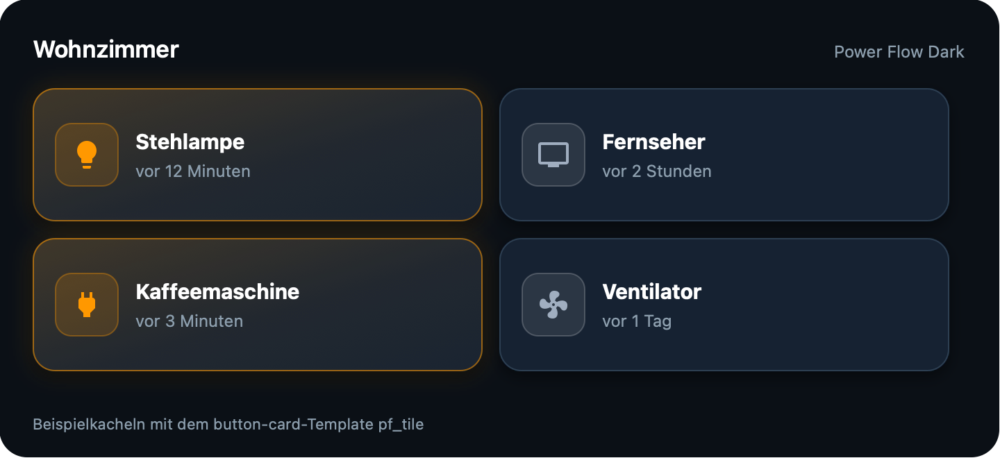
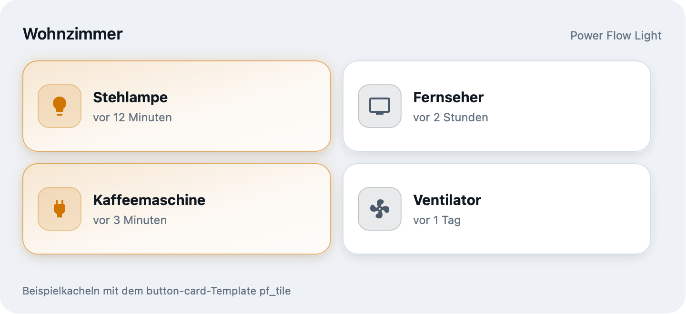

# Power Flow – Home Assistant Theme

**English** · [Deutsch](#deutsch)

A custom Home Assistant theme (tested with HA OS, Core 2026.11) with card-mod styling for every dashboard card.





## Included themes

| Theme | Mode | Accent |
|---|---|---|
| Power Flow Dark | dark | blue |
| Power Flow Light | light | blue |
| Power Flow | automatic (follows the device) | blue |
| Power Flow Dark/Light Smaragd | dark / light | emerald green |
| Power Flow Dark/Light Violett | dark / light | violet |
| Power Flow Dark/Light Türkis | dark / light | turquoise |
| Power Flow Dark/Light Koralle | dark / light | coral red |

All accent variants have the same luminance as the original blue, so the WCAG contrast ratios stay the same.

## Repository layout

```
themes/power_flow.yaml               theme file (all themes), installed by HACS
hacs.json                            HACS metadata
button-card-templates/               button-card templates used in the dashboards
  haussteuerung.yaml                 pf_tile (switch tile), pf_mini (small action buttons)
  energie-uebersicht.yaml            pf_stat_card (statistics card)
tools/gen_variants.py                generates the accent variants
tools/make_preview.py                generates the preview images (SVG, in images/)
images/                              preview images for the README and HACS
```

Shared parts exist only once in the theme file, as YAML anchors:

- `&pf_card_mod`: CSS applied to every dashboard card (hover, focus, rules per card type)
- `&pf_map`: maps all HA variables to the `pf-*` palette
- `&pf_dark_mode` / `&pf_light_mode`: the two palettes

The variants take over a palette with `<<:` and only override the accent colors.

## Installation

Requirements: [card-mod](https://github.com/thomasloven/lovelace-card-mod), and [button-card](https://github.com/custom-cards/button-card) for the templates.

`configuration.yaml` must load themes from the `themes` folder:

```yaml
frontend:
  themes: !include_dir_merge_named themes
```

### Via HACS / Marketplace

1. Open HACS (or, from HA 2026.11, **Settings → Marketplace**).
2. Menu ⋮ → **Custom repositories** (Marketplace: **Add from link**), enter this repository's URL, category **Theme**.
3. Search for “Power Flow” and download it. The file is placed at `/config/themes/power_flow.yaml`.
4. Run the action `frontend.reload_themes` and pick the theme in your profile.

Updates then show up automatically in HACS / the Marketplace.

### Manual

Copy `themes/power_flow.yaml` to `/config/themes/`, then run `frontend.reload_themes`.

> Do not use both ways at once: if the file exists twice under `/config/themes/`, every theme is defined twice.

### button-card templates

HACS does not install the templates. Add them to the dashboard configuration under `button_card_templates:` (dashboard → edit raw configuration).

## Regenerating the variants

`tools/gen_variants.py` calculates the accent colors and primary scales and writes `variants.yaml`. Replace the block in the theme file starting at “AKZENT-VARIANTEN” with it.

## License

MIT, see [LICENSE](LICENSE).

---

<a id="deutsch"></a>

# Power Flow – Home-Assistant-Theme

[English](#power-flow--home-assistant-theme) · **Deutsch**

Eigenes Theme für Home Assistant (getestet mit HA OS, Core 2026.11) mit card-mod-Styling für alle Dashboard-Karten. Vorschaubilder siehe oben.

## Enthaltene Themes

| Theme | Modus | Akzent |
|---|---|---|
| Power Flow Dark | dunkel | Blau |
| Power Flow Light | hell | Blau |
| Power Flow | automatisch (folgt dem Gerät) | Blau |
| Power Flow Dark/Light Smaragd | dunkel / hell | Grün |
| Power Flow Dark/Light Violett | dunkel / hell | Violett |
| Power Flow Dark/Light Türkis | dunkel / hell | Türkis |
| Power Flow Dark/Light Koralle | dunkel / hell | Korallrot |

Alle Akzent-Varianten haben dieselbe Leuchtdichte wie das Original-Blau, die WCAG-Kontraste bleiben also gleich.

## Aufbau

```
themes/power_flow.yaml               Theme-Datei (alle Themes), wird von HACS installiert
hacs.json                            HACS-Beschreibung des Repos
button-card-templates/               button-card-Templates der Dashboards
  haussteuerung.yaml                 pf_tile (Schalter-Kachel), pf_mini (kleine Aktionsbuttons)
  energie-uebersicht.yaml            pf_stat_card (Kennzahl-Karte)
tools/gen_variants.py                erzeugt die Akzent-Varianten
tools/make_preview.py                erzeugt die Vorschaubilder (SVG, in images/)
images/                              Vorschaubilder für README und HACS
```

In der Theme-Datei gibt es die gemeinsamen Teile nur einmal, als YAML-Anker:

- `&pf_card_mod`: CSS für jede Dashboard-Karte (Hover, Fokus, Kartentyp-Regeln)
- `&pf_map`: Zuordnung aller HA-Variablen zur `pf-*`-Palette
- `&pf_dark_mode` / `&pf_light_mode`: die beiden Paletten

Die Varianten übernehmen eine Palette per `<<:` und überschreiben nur die Akzentfarben.

## Installation

Voraussetzungen: [card-mod](https://github.com/thomasloven/lovelace-card-mod) und für die Templates [button-card](https://github.com/custom-cards/button-card).

In `configuration.yaml` müssen Themes aus dem Ordner `themes` geladen werden:

```yaml
frontend:
  themes: !include_dir_merge_named themes
```

### Über HACS / Marketplace

1. HACS (bzw. ab HA 2026.11 **Einstellungen → Marketplace**) öffnen.
2. Menü ⋮ → **Benutzerdefinierte Repositories** (Marketplace: **Aus Link hinzufügen**), URL dieses Repos eintragen, Kategorie **Theme**.
3. „Power Flow“ suchen und herunterladen. Die Datei landet unter `/config/themes/power_flow.yaml`.
4. Aktion `frontend.reload_themes` ausführen und im Profil das Theme wählen.

Updates erscheinen danach automatisch in HACS / im Marketplace.

### Manuell

`themes/power_flow.yaml` nach `/config/themes/` kopieren, dann `frontend.reload_themes` ausführen.

> Nicht beide Wege gleichzeitig nutzen: Liegt die Datei doppelt unter `/config/themes/`, sind die Themes doppelt definiert.

### button-card-Templates

Die Templates installiert HACS nicht mit. Sie gehören in die Dashboard-Konfiguration unter `button_card_templates:` (Dashboard → Rohkonfiguration bearbeiten).

## Varianten neu erzeugen

`tools/gen_variants.py` berechnet die Akzentfarben und Primär-Skalen und schreibt `variants.yaml`. Den Block ersetzt man in der Theme-Datei ab „AKZENT-VARIANTEN“.

## Lizenz

MIT, siehe [LICENSE](LICENSE).
